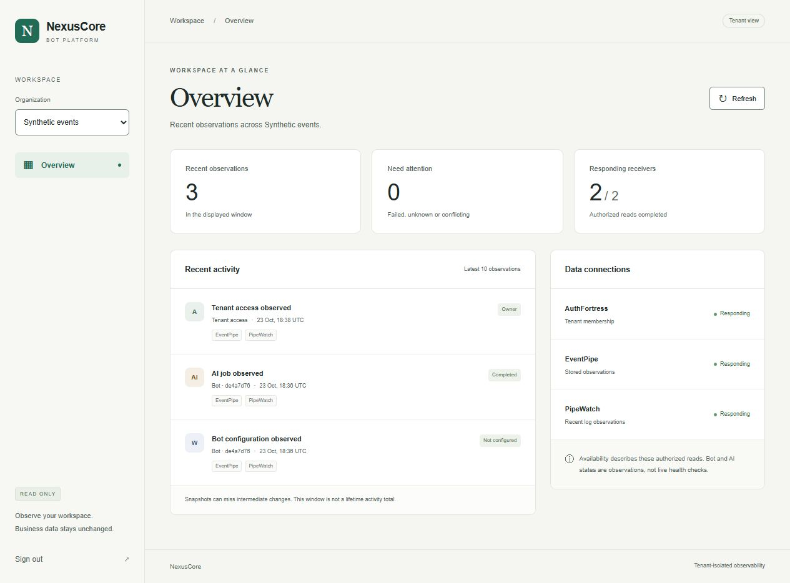
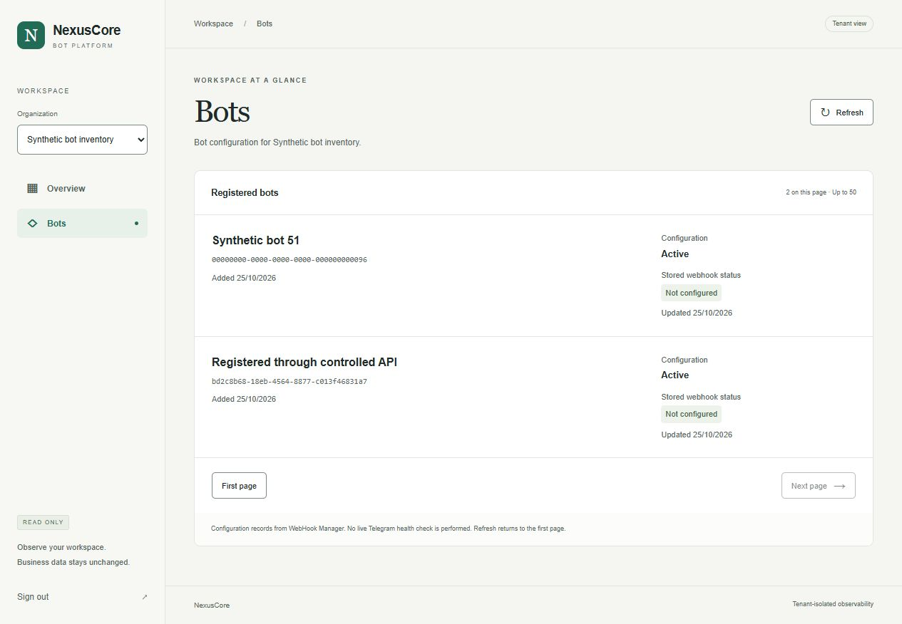
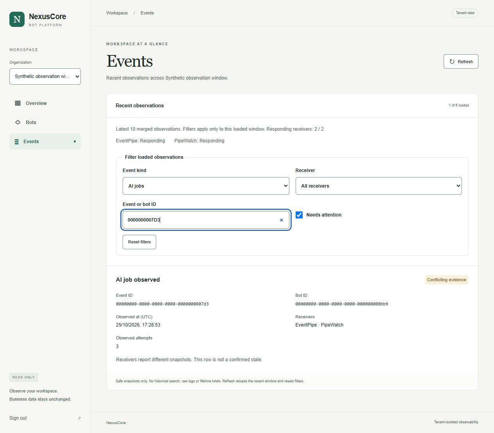
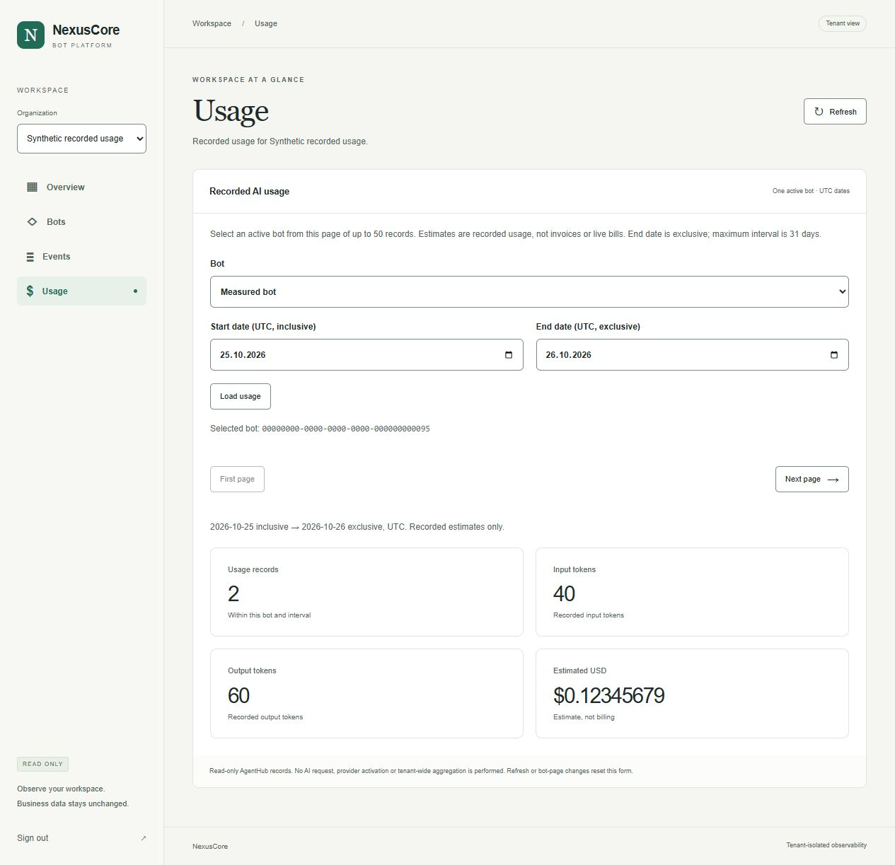
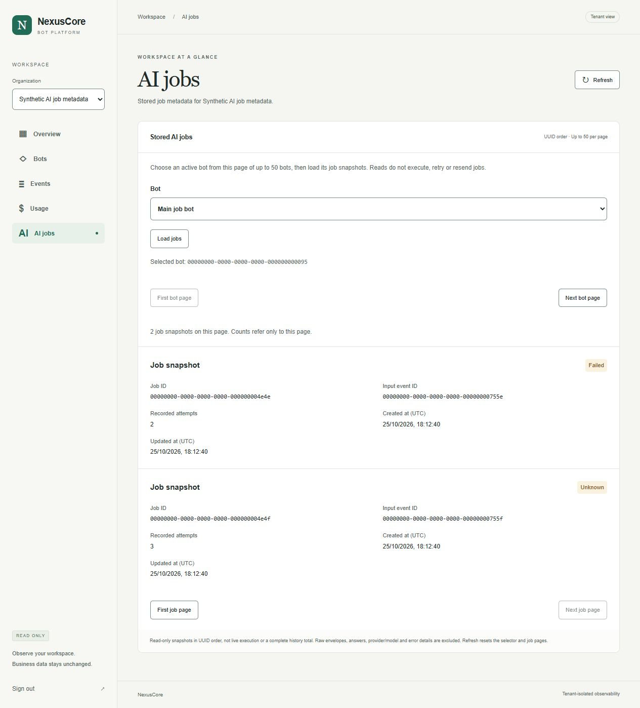
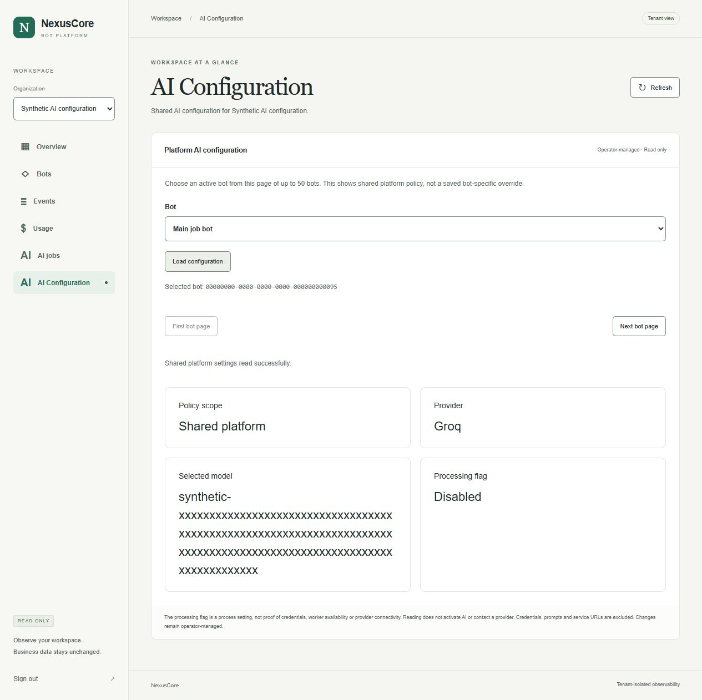
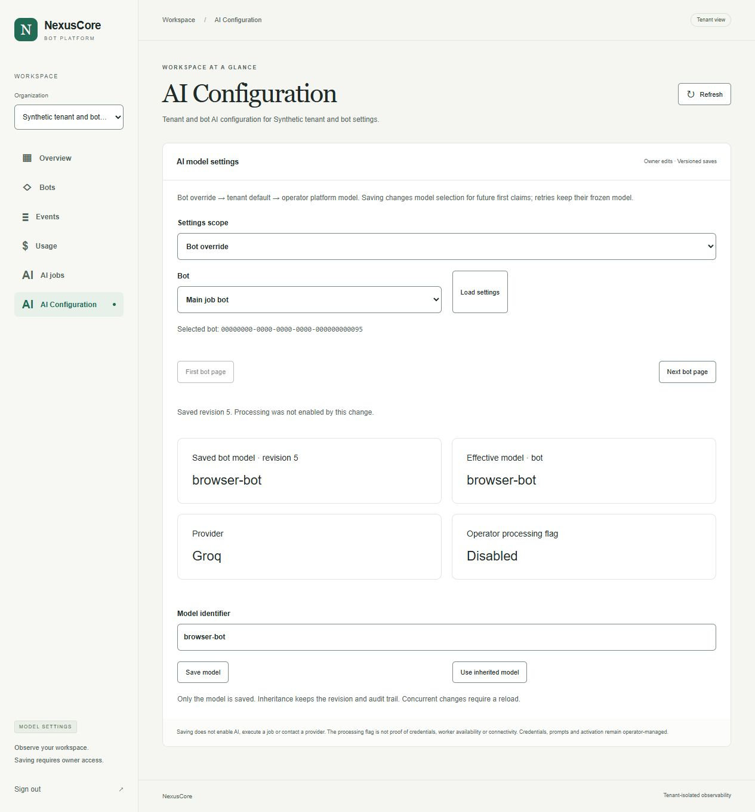

# NexusCore dashboard

Opt-in tenant Overview, Bots, Events, Usage, AI jobs and AI Configuration using existing AuthFortress,
WebHook Manager, AgentHub, EventPipe query and PipeWatch HTTP contracts. Overview displays up to ten recent
safe observations and authorized receiver availability. Bots displays a paged
configuration inventory; Usage reads one active bot's recorded token/cost
estimates for an explicit UTC date interval. Snapshots are not current bot health or lifetime totals.
This package does not start or modify the root deployment.

## Run locally

Use Node.js 24 and npm. First prepare a separate isolated service fixture with
synthetic accounts and events. Expose only its AuthFortress, EventPipe query and
PipeWatch, WebHook Manager and AgentHub read HTTP APIs on unused `127.0.0.1` ports. An `internal` Docker network does
not provide usable published ports; keep it isolated and use a bounded local
docker-exec HTTP bridge for that fixture, as in the acceptance record. Never use the main deployment's
environment file or enable provider workers for dashboard verification.

In PowerShell, from `dashboard/`:

```powershell
npm ci
Copy-Item .env.example .env.local
# Set the five service origins to the isolated fixture's actual loopback ports.
# DASHBOARD_ORIGIN must match the browser URL, including its port.
npm run dev
```

Open `http://127.0.0.1:3000` and sign in with an account created in that fixture.
Select an authorized organization and switch between Overview and Bots. Refresh
returns to the first page. Bots uses Next page/First page and up to 50 records
per response, without claiming a total. Names, activity flags and stored webhook
states come from scoped configuration reads; no live Telegram health request is
made. Overview, Bots, Events, Usage and AI jobs have no business mutation controls
or automatic polling. AI Configuration supports owner-only model changes.

Events inspects the same ten merged observations as Overview, with full event/
bot IDs, UTC times, receiver evidence and observed attempt counts. Kind,
receiver, attention and ID filters combine locally without extra requests.
They apply only to the loaded window; Reset filters restores that window.
Refresh, organization and section changes reset filters. This is not historical
search or a complete audit log. Receiver names/statuses distinguish partial and
unavailable reads; conflicting snapshots are explicitly marked.

Usage uses the existing paged Bots inventory for its active-bot selector. Choose
UTC start-inclusive/end-exclusive dates (at most 31 days), then Load usage.
The initial range is the current UTC day. Names and bot pages are authorized
configuration reads; AgentHub independently checks ai.read and fresh active bot
context. Zero totals require a successful read; failures never become zero usage.
Money stays an exact eight-decimal string, including tiny/zero Decimal values.
These estimates are recorded values, not invoices, live bills or tenant-wide
totals. Changing form inputs clears/aborts previous results; Refresh, tenant,
section and bot-page changes reset the form. No provider is enabled by reads.
AgentHub reads require `PLATFORM_READ_ENABLED=true` only in the isolated fixture;
keep AI processing, real credentials and workers disabled. Setting a dashboard
origin does not activate a backend feature.

AI jobs uses the same active-bot selector with an explicit Load jobs action.
First bot page/Next bot page select a bot inventory page; First job page/Next
job page navigate its stored job metadata separately. A full 50-job page can
be the final page, following AgentHub's existing cursor contract. Only job/event
IDs, known states, recorded attempts and UTC timestamps are shown. Bot, scope,
section, Refresh and bot-page changes clear/abort prior results. Reads do not
execute, retry, reconcile or resend jobs. Raw envelopes, answers, errors,
provider/model and worker claims are excluded.

AI Configuration loads tenant defaults or active bot overrides. Tenant defaults
work without a bot. Effective precedence is bot > tenant > operator platform;
provider stays Groq. Load settings before editing. Owners may Save model or
Use inherited model; members read only. Saves use optimistic revisions and
atomic audit receipts. Conflicts and unconfirmed writes require reload, without
automatic retry. Scope/navigation controls are locked while saving. Changes
apply to future first job claims; retry retains the frozen model.
The operator processing flag stays read-only and does not prove credentials,
workers or connectivity. No keys, key-presence probes, prompts or service URLs.
AgentHub needs the new `/ai/settings` endpoints and clean migration003_ai_settings;
never migrate the main deployment or merge foreign migration WIP implicitly.
Bot/page/scope/section/Refresh changes clear loaded settings and local drafts.

To check and run the optimized build:

```powershell
$env:NEXT_TELEMETRY_DISABLED='1'
npm test
npm run typecheck
npm run lint
npm run build
npm audit
npm start
```

Production mode uses Secure cookies. The local acceptance uses Chromium's secure
loopback handling; an eventual remote deployment requires a separately reviewed
HTTPS/origin/proxy configuration. Current browser origins intentionally allow
only numeric IPv4 loopback, not public hosts or forwarded headers.

## Boundaries

Knowledge Base lists tenant-scoped document metadata in pages of 50. A full
page may be followed by an empty page; records may shift between offset pages
when documents are added or removed. The issuer and AgentHub authorize each
read. AgentHub requires `PLATFORM_TENANT_ENABLED=true` on the isolated service;
enabling that feature on an existing deployment is a separate operation. The
view does not upload, delete, expose file paths or run embeddings.
- Access and temporary 2FA credentials stay in HttpOnly, SameSite=Strict cookies.
  The server discards refresh credentials; access cookies expire after 15 minutes.
  Sign in again when the issuer session expires. Existing issuer rate limits,
  2FA/backup codes and membership authorization remain authoritative.
- Each Overview request checks current issuer membership before any sink query.
  Every sink request carries that identity and canonical tenant scope. No shared
  user cache, sibling imports, database access or secret-bearing browser config.
- Each Bots request repeats issuer membership before the WebHook Manager read.
  The BFF validates tenant, UUID ordering/cursors, active flags, known webhook
  states and dates. Bot and organization names follow their backends' 128
  Unicode code point limits.
  Tokens, ciphertext, Telegram identifiers, usernames and webhook URLs are
  excluded. Tenant/section changes clear prior data and abort stale reads.
- Each Usage request repeats issuer membership before AgentHub's scoped read.
  Counts must be nonnegative safe integers. Bounded Decimal strings are normalized
  with integer arithmetic; malformed/oversize/negative/inexact values fail closed.
  Provider/model names, messages and raw usage records are excluded.
- Each AI jobs request repeats issuer membership before AgentHub's scoped read.
  Job IDs must be strictly ordered, input event IDs unique, attempts bounded and
  dates valid before UTC normalization. Invalid source pages fail closed.
- Server-only origins accept explicit numeric private/loopback HTTP(S) addresses.
  Direct requests ignore proxies, reject redirects and have bounded JSON sizes
  and five-second absolute deadlines. Wrong Host/Origin mutations are rejected.
- Only the existing three observation types are supported. The browser receives
  fixed labels, safe states, canonical IDs, timestamps and receiver evidence.
  Raw payloads, logs, previews, request/answer/provider data never reach the UI.
- Unavailable or malformed receivers are shown explicitly. A successful query is
  not a comprehensive health check. Differing safe content for a relay UUID is
  shown as conflicting evidence. Unknown event types can occupy a recent window;
  older supported observations are not scanned automatically.
- Organization pages contain up to 50 memberships. Tenant switches clear prior
  observations and abort stale reads. Logout clears cookies and requests issuer
  revocation; failures say when issuer sign-out could not be confirmed.

No registration, OAuth, refresh workflow, bot editing, credential/processing activation, billing, Telegram alerts,
public deployment or main-stack activation in this increment.

Contract: [dashboard-overview.md](../specs/dashboard-overview.md).
Bots contract: [dashboard-bots.md](../specs/dashboard-bots.md).
Events contract: [dashboard-events.md](../specs/dashboard-events.md).
Usage contract: [dashboard-usage.md](../specs/dashboard-usage.md).
AI jobs contract: [dashboard-jobs.md](../specs/dashboard-jobs.md).
AI Configuration contract: [dashboard-ai-configuration.md](../specs/dashboard-ai-configuration.md).
Saved settings contract: [tenant-ai-settings.md](../specs/tenant-ai-settings.md).
Verification: [Overview acceptance](../docs/dashboard-overview-2026-10-23.md),
[Bots acceptance](../docs/dashboard-bots-2026-10-25.md),
[Events acceptance](../docs/dashboard-events-2026-10-25.md),
[Usage acceptance](../docs/dashboard-usage-2026-10-25.md),
[AI jobs acceptance](../docs/dashboard-jobs-2026-10-25.md),
[AI Configuration acceptance](../docs/dashboard-configuration-2026-10-26.md).

Saved settings verification: [tenant/bot settings acceptance](../docs/tenant-ai-settings-2026-10-26.md).














