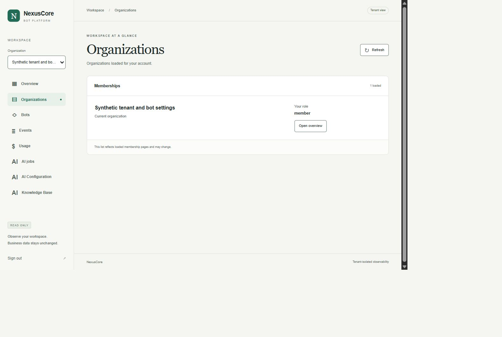
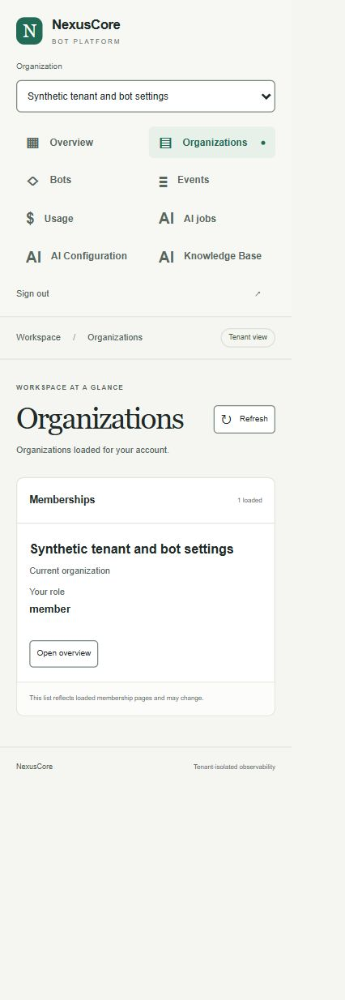

# Organizations refresh acceptance — 2026-10-28

## Change

The read-only directory now has an explicit Refresh control. It clears loaded
membership pages, selection and scoped data before rereading offset zero.
Successful refresh selects the first returned organization. Pending, failed and
empty successful reads are distinct; failed reads allow an explicit retry.
Logout, session expiry and unmount cancel membership reads, and aborted responses
cannot restore the workspace. No polling, business writes or new dependencies.

The existing membership BFF also stops advertising a next page when offset + 50
would exceed 100000. Loaded counts remain snapshot counts, not totals.

## Checks

Commands run from `D:/Programming/NexusCore/dashboard`:

```powershell
npm test
npm run lint
npm run typecheck
npm run build
npm audit
```

- 65 tests passed; Biome checked 42 files; TypeScript and production build passed.
  Dependency audit reported zero vulnerabilities.
- `node --test dashboard/tests/routes.test.ts` from the repository root: 15 passed.
  New HTTP coverage proves fresh role changes, an empty issuer result, safe
  401/403/503 handling and boundary offsets 99950/99951/99999/100000/100050.
- The pagination regression failed before the fix (`true !== false`) and passed
  afterwards, including valid offsets that are not multiples of 50.
- Fresh independent adversarial and scoped security review: APPROVE, no confirmed
  code findings. The reviewer reran tests/lint/types/audit and independently
  exercised membership cancellation and late-response handling with a hook probe.
  That probe is supplementary evidence, not a replacement for React/Chromium.
- `git diff --check`: passed; existing Windows LF/CRLF warnings only.

## Isolated Docker and browser evidence

Docker Engine 29.8.2 responded on `desktop-linux`. Before fixture creation,
read-only inventory captured 820 containers, 441 volumes and 99 networks,
including nine running containers and 80 stopped scanners. Main database
rows/schema/sequences, uploads, protected files, release files and WSL settings
were fingerprinted without retaining data or credential values.

Private local acceptance commands from the root:

```powershell
python .venv/inventory_organizations_20261028.py before
python .venv/verify_organizations_20261028.py
python .venv/control_organizations_20261028.py down-on
python .venv/control_organizations_20261028.py down-off
python .venv/control_organizations_20261028.py member-owner
python .venv/control_organizations_20261028.py member-empty
python .venv/control_organizations_20261028.py member-restore
python .venv/control_organizations_20261028.py slow-on
python .venv/control_organizations_20261028.py slow-off
python .venv/inventory_organizations_20261028.py after
```

These ignored local helpers reuse existing immutable fixture images and generate
a new UUID Compose project each run. They are evidence collectors on this
workstation, not a portable public test suite. No existing deployment or sibling
checkout was modified. Each fixture used six services, three fresh volumes, one
internal network, no published ports, no workers and no restart policies. A
bounded loopback bridge accessed only the owned HTTP services. Feature flags and
synthetic records were scoped to the new fixture.

Attempts retained:

| Project suffix | Result |
| --- | --- |
| `b2483096918543f18c2b32e1ea19f587` | Unchanged build baseline: Organizations has no Refresh control. |
| `1eb41c804d9843cf9c7a870cd4043fd1` | HTTP checks passed; browser attempt rejected after a concurrent rebuild left the running server referencing a removed chunk. |
| `c510ddc5f3a9442b92b9200aa55890e2` | Final production build, Docker HTTP and browser acceptance passed. |

Final actual Chromium checks:

- Owner membership pages load 50 then 52 rows. Refresh immediately clears rows
  and shows loading; success returns to 50 with more pages available.
- Controlled issuer failure shows unavailable, clears rows and permits Refresh;
  restoration returns 50 rows without signing in again.
- Member sees only one membership. Changing its synthetic role is reflected by
  Refresh. Revocation makes Open overview fail authorization; refreshing the
  directory returns a successful empty result. Restoring membership reloads it.
- During a delayed refresh, signing out in a second tab causes expiry in the
  first; no rows or workspace reappear after the delayed response.
- Actual CSS viewport widths 1280 and 360: no horizontal overflow. Console
  warnings/errors: zero. Temporary viewport settings were reset and test tabs closed.
- Existing six-service HTTP probes also passed owner/member Knowledge reads
  50+2, empty/foreign tenant denial, safe projections and logout. Foreign denial
  was checked before an AgentHub read. Controlled setup/Groq/send/error counters
  remained zero after browser acceptance.

Final preservation comparison is performed only after all owned services stop.
The first after-snapshot ran during teardown and was rejected for still-running
new containers; it is not acceptance evidence. The subsequent stopped-state
comparison is the final preservation gate.
It passed: all 820 original container records, 441 volume records and 99 network
records match exactly, images are retained, and main data/uploads/protected/WSL
fingerprints match. All 18 new containers stopped with exit 0 and no OOM. Final
inventory: 838 containers, 450 volumes, 102 networks; the original nine running
containers and 80 stopped scanners retain their states. Nothing was deleted.

## Limits

This verifies a local opt-in dashboard and synthetic isolated services. It does
not establish public deployment, complete membership history, real Telegram/LLM
behavior or overall roadmap completion. Main and other retained stands are not
used for functional tests. The existing root README and two local hardening WIP
files remain outside this change.




